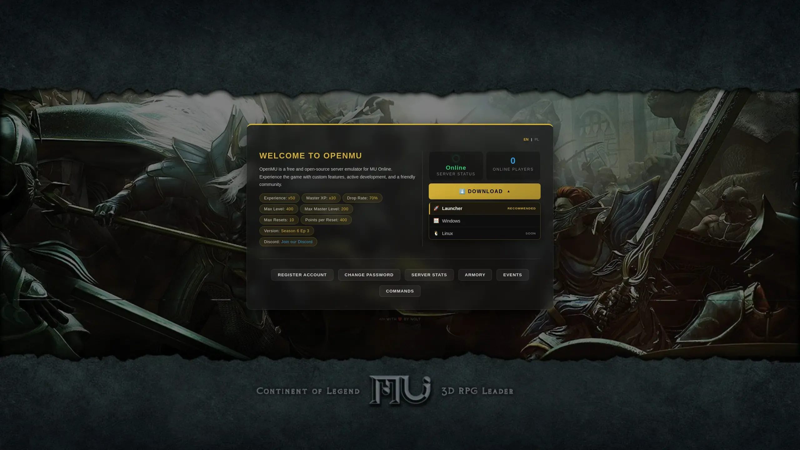

# openmu-simple-web

🇬🇧 [English version](README.md)

Prosta strona internetowa dla serwera OpenMU.

Strona powstała dla mojego zestawu do budowania serwera OpenMU: https://github.com/nolt/openmu-docker  
Rozmawia z **website API panelu administracyjnego OpenMU** w tej samej sieci Dockera; z bazą danych
się nie łączy.

Strona jest wielojęzyczna: angielski i polski.

## Co oferuje strona:
- rejestracja nowego konta
- zmiana hasła
- status serwera i liczba graczy online
- ranking TOP 10
- odliczanie do eventów (BC/DS/CC itd.), opcjonalnie z pełnym rozkładem godzin
- armory (podgląd ekwipunku postaci): obrazek klasy postaci i opisy przedmiotów jak w grze
  (statystyki, wymagania, opcje, bonusy zestawów ancient, sockety); rendery klas, obrazki przedmiotów
  i dane przedmiotów w `wwwroot/data` pochodzą z klienta gry MU Online (MuMain, Season 6)
- lista komend czatu

## Jak to działa

Dwa kontenery z oficjalnych obrazów, nic się nie buduje:

- **nginx** serwuje pliki z `wwwroot/` (skrypty stron, style, obrazki), a resztę przekazuje do PHP,
- **PHP-FPM** renderuje strony i odpowiada skryptom stron; dane bierze z website API OpenMU
  (`/api/website/...`) z krótkim cache, więc odwiedzający nie obciążają serwera gry.

Kod jest montowany z tego katalogu, więc aktualizacja to `git pull` - bez przebudowy i bez restartu.
Twoje teksty i ustawienia leżą w `config/site.local.php`, którego aktualizacja nigdy nie rusza.

## Wymagania
- Docker z Docker Compose
- OpenMU z website API (master od listopada 2026) w sieci Dockera `openmu-network`

## Instalacja

```bash
git clone https://github.com/nolt/openmu-simple-web.git
cd openmu-simple-web
cp .env.example .env                                  # potem uzupełnij, patrz niżej
cp config/site.local.example.php config/site.local.php   # opcjonalnie: twoje teksty i linki
docker compose up -d
```

Strona nasłuchuje na porcie `WEB_PORT` (domyślnie 8088).

## Klucz API OpenMU

Strona potrzebuje klucza API z rolą **Website (selected functions only)** (`WebManager`):

1. W panelu administracyjnym otwórz **API keys** i utwórz klucz (np. `website`) z tą rolą.
2. W **Website functions** zaznacz: **Server status**, **Register accounts**, **Character ranking**,
   **Event schedule**, **Character profiles (equipped items)** i **Change account passwords**.
   Niezaznaczona funkcja odpowiada `403`; strona pokazuje wtedy serwer jako niedostępny albo stronę
   jako niedostępną i zapisuje przyczynę w logu (`docker logs openmu-website-php`).
3. Skopiuj klucz - pokazuje się tylko raz - do `.env` jako `OPENMU_API_KEY=...` i uruchom
   `docker compose up -d`.

`OPENMU_API_URL` to panel administracyjny widziany z kontenera strony, domyślnie
`http://openmu-server:8080`. Klucz zostaje na serwerze; nigdy nie trafia do przeglądarki.

## Twoje ustawienia i teksty (`config/site.local.php`)

`config/site.php` zawiera wartości domyślne: nazwę strony, języki, teksty strony głównej, dane
serwera, linki do pobrania. Nie edytuj go - aktualizacja go podmienia. To, co zmieniasz, wpisz do
`config/site.local.php` (zacznij od `config/site.local.example.php`):

```php
<?php
return [
    'siteName' => 'MyMU',
    'defaultLanguage' => 'pl',
    'content' => [
        'pl' => ['welcomeTitle' => 'Witaj na MyMU'],
    ],
];
```

- Wystarczą klucze, które zmieniasz; reszta przychodzi z `config/site.php`, więc nowe ustawienia
  z aktualizacji pojawiają się z wartością domyślną.
- Listy (`downloads`, `rows`, `timetable`...) zastępują domyślną listę w całości - kopiuj całą listę.
- Zmiana jest widoczna po odświeżeniu strony.

### Linki do pobrania

```php
'downloads' => [
    ['id' => 'launcher', 'icon' => '🚀', 'name' => 'Launcher', 'url' => 'https://...', 'recommended' => true],
    ['id' => 'android', 'icon' => '📱', 'name' => 'Android', 'url' => '#', 'soon' => true],
    ['id' => 'linux', 'icon' => '🐧', 'name' => 'Linux', 'url' => 'https://...'],
    ['id' => 'windows', 'icon' => '🪟', 'name' => 'Windows', 'url' => 'https://...'],
],
```

- `url` - link do pobrania. **Dostarczone wartości to zaślepki `#` - ustaw własne.**
- `recommended` - wyróżnia pozycję (np. samoaktualizujący się launcher).
- `soon` - pokazuje ją jako nadchodzącą, nieklikalną.

Link do Discorda w danych serwera na stronie głównej (`url` pozycji `Discord` w `content`, osobno dla
każdego języka) to również zaślepka `#` - wpisz tam zaproszenie na swój serwer.

### Nawigacja, tytuły kart, własne strony

- `nav` - linki w stopce: `[ścieżka, klucz tłumaczenia, tekst]`, w tej kolejności.
- `pageTitles` - tytuły kart pojedynczych stron, np. `['/' => 'MyMU - Najlepszy serwer']`; strony
  bez wpisu mają tytuł „`siteName` - strona”.
- Własna strona to widok w `app/views/pages/<nazwa>.php` (wzoruj się na istniejących) - jest dostępna
  pod `/<nazwa>` - plus link w `nav`. Własne widoki trzymaj we własnym forku; aktualizacja ich nie
  usuwa, ale to część kodu, a nie configu.
- Przy jednym języku w `languages` przełącznik języka jest ukryty.

### Rozkład eventów

API OpenMU podaje najbliższy start każdego aktywnego eventu, więc każdy event pokazuje odliczanie
i godzinę startu. Żeby pokazać też pełny rozkład godzin, czas trwania i mnożnik doświadczenia, dodaj
je w sekcji `events`, pod nazwą widoczną na stronie:

```php
'events' => [
    'Blood Castle' => ['timetable' => ['00:00', '02:00', '04:00'], 'durationMinutes' => 15],
    'Happy Hour' => ['timetable' => ['20:00'], 'durationMinutes' => 60, 'experienceMultiplier' => 1.5],
    // eventy tygodniowe: dzień każdego startu, 0 = niedziela
    'Crywolf' => ['timetable' => ['20:00', '20:00'], 'days' => [3, 6], 'durationMinutes' => 30],
],
```

Nie trzeba tego przepisywać ręcznie: `tools/events-timetable.sql` wypisuje tę sekcję z bazy OpenMU
(tylko odczyt), gotową do wklejenia:

```bash
docker exec -i openmu-postgres psql -U postgres -d openmu -At < tools/events-timetable.sql
```

To kopie konfiguracji serwera gry: gdy zmienisz rozkład w panelu administracyjnym, uruchom zapytanie
ponownie. Odliczanie eventów codziennych zawsze przychodzi z serwera. Crywolf i Castle Siege mają
własne harmonogramy, których API nie podaje - pojawiają się na stronie tylko z wpisem tutaj, a ich
najbliższy start jest z niego wyliczany.

Godziny są pokazywane w strefie czasowej `TIMEZ` z `.env` (np. `Europe/Warsaw`). Ustaw strefę
serwera gry (panel administracyjny, konfiguracja systemu) - tę, w której zapisany jest rozkład.

## Dodawanie nowego języka

1. **Utwórz plik tłumaczenia**
   - Skopiuj `wwwroot/template_lang.js` (pusty szkielet ze wszystkimi kluczami) - albo przetłumaczony
     już `wwwroot/en.js` - pod kodem swojego języka, np. `de.js` dla niemieckiego.
   - Zmień klucz obiektu w linii 2 (`window.muTranslations.xx`) na swój kod, np. `.de`.
   - Uzupełnij każdą wartość tłumaczeniem.

2. **Dodaj go do `languages`** w `config/site.local.php`, np. `'languages' => ['en', 'pl', 'de']`.
   Każda strona wczytuje wymienione języki; przyciski przełącznika idą w tej kolejności.

3. **Teksty strony głównej (opcjonalnie)** - dodaj sekcję `de` w `content`. Bez niej strona główna
   używa tekstów języka domyślnego.

4. **Opisy przedmiotów w armory (opcjonalnie)** - skopiuj `wwwroot/js/item-texts.pl.js` do
   `item-texts.de.js`, zmień `window.muItemTexts.pl` na `.de`, przetłumacz wartości (klucze to teksty
   angielskie) i dodaj plik do skryptów w `app/views/pages/armory.php`. Bez niego opisy zostają po angielsku.

Etykieta przycisku to kod wielkimi literami (np. `DE`); ładniejszą dodasz w mapie `LABELS`
w `wwwroot/lang.js`. Żeby strona startowała w innym języku, ustaw `defaultLanguage`.

## Aktualizacja

```bash
git pull
```

To wszystko: nginx i PHP czytają pliki z tego katalogu, więc nowa wersja działa od razu.
`docker compose up -d` uruchom tylko, gdy zmienił się `docker-compose.yaml` albo `.env`.
Po aktualizacji odwiedzający mogą potrzebować jednorazowo odświeżyć stronę (Ctrl+F5), żeby dostać nowe skrypty.

## Za reverse proxy (HAProxy, nginx…)

Rejestracja (1 konto na 24h na IP), zmiana hasła i limity zapytań liczą się per IP
odwiedzającego. Za proxy strona widzi tylko adres proxy, więc wszyscy dzielą jeden limit.
Żeby to naprawić:

1. Proxy ma przekazywać IP odwiedzającego: HAProxy `option forwardfor` w backendzie
   (`mode http`), nginx `proxy_set_header X-Forwarded-For $proxy_add_x_forwarded_for;`.
2. Wpisz do `.env` adres, z którego łączy się proxy: `TRUSTED_PROXIES=...`
   (IP lub CIDR po przecinku). Dla proxy na hoście Dockera to bramka sieci Dockera strony:
   `docker inspect openmu-website -f '{{range .NetworkSettings.Networks}}{{.Gateway}} {{end}}'`.
3. Wpuszczaj odwiedzających tylko przez proxy: przy proxy na tym samym hoście ustaw w `.env`
   `WEB_BIND=127.0.0.1` (albo niech proxy łączy się bezpośrednio z kontenerem, a port usuń). Inaczej
   odwiedzający, który połączy się z portem strony z pominięciem proxy - np. przez IPv6, które Docker
   przekazuje z adresu bramki - byłby traktowany jak proxy.
4. Uruchom `docker compose up -d`.

Ufamy tylko wpisanym proxy, więc odwiedzający nie obejdą limitów podrobionym nagłówkiem.
Odwiedzający z IPv6 są liczeni per sieć /64 - blok, który zwykle dostaje jedno łącze.

## Przejście z wersji C#

Do wersji 1 strona była aplikacją ASP.NET czytającą bazę danych. Ta wersja zostaje dostępna na
branchu `csharp` (tag `v1-csharp`). Żeby przejść na tę wersję:

1. Utwórz klucz API jak opisano wyżej i zanotuj go.
2. Zachowaj swoje teksty: stary `wwwroot/content.js` staje się `config/site.local.php` - przepisz do
   niego teksty powitania, dane serwera, `maxResets` i linki do pobrania (te same nazwy, składnia PHP).
3. Zatrzymaj starą stronę: `docker compose down`, potem `git pull` (jeśli git odmówi z powodu
   zmienionego `content.js`, najpierw `git stash` - stary plik zostanie w stashu). Upewnij się, że
   `wwwroot/content.js` potem zniknął: plik w tym miejscu byłby serwowany zamiast twoich ustawień.
   Rozkładu eventów nie trzeba przepisywać - wypisze go `tools/events-timetable.sql`.
4. Napisz nowy `.env` na podstawie `.env.example`: `OPENMU_API_URL`, `OPENMU_API_KEY`; ustawienia
   `DB_*` i `SERVER_CHECK_*` znikają. `WEB_PORT`, `TRUSTED_PROXIES` i `TIMEZ` zostają; `WEB_BIND` jest nowe.
5. `docker compose up -d`. Stary obraz `openmu-web:latest` można usunąć: `docker image rm openmu-web:latest`.

Co zmieniło się dla graczy:
- Rejestracja nie pyta już o kod bezpieczeństwa (API go nie przyjmuje). Takie konto kasuje postacie
  w grze hasłem konta.
- Ranking jest rankingiem serwera: kolejność resety, master level, level; botów i GM-ów nie ma na liście.
- Zmiana hasła jest odrzucana, gdy konto jest w grze albo na levelowaniu offline, a serwer blokuje
  konto na 15 minut po 5 błędnych hasłach.

---
Przykład:

---
Więcej informacji o projekcie OpenMU znajdziesz tutaj:
https://github.com/MUnique/OpenMU

## Licencja
[MIT](LICENSE)

Autor oryginalny: [Nolt](https://github.com/nolt).
